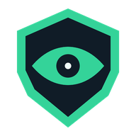
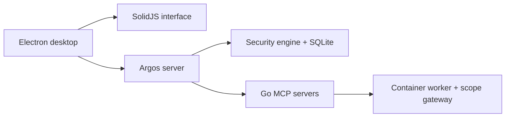

<p align="center">
  
</p>

<h1 align="center">Argos</h1>

<p align="center"><strong>One workspace for scope, evidence, and security findings.</strong></p>
<p align="center">AI-assisted Web/API and code audits. A local desktop workspace. You direct the investigation.</p>

<p align="center">
  <a href="LICENSE"></a>
  <a href="docs/installation.md"></a>
  <a href="https://github.com/iwiels/ARGOS/actions/workflows/ci.yml"></a>
</p>

<p align="center">
  <a href="#start-from-source">Get started</a> ·
  <a href="#what-you-can-do">Capabilities</a> ·
  <a href="docs/installation.md">Installation</a> ·
  <a href="docs/runtime-controls.md">Runtime controls</a> ·
  <a href="CONTRIBUTING.md">Contribute</a>
</p>

---

Argos brings the audit conversation, scanner output, finding review, and engagement record into the same desktop application. Define the authorized scope, direct specialized AI agents, review the evidence, and carry findings into a report.

**Scope → Investigate → Review → Track → Report**

> **Source prerelease.** Build Argos from this repository. Versioned installers and a supported update feed are not available yet. Web audits require the pinned container worker and a passing runtime preflight. See [capabilities and limits](docs/capabilities.md) and the [verification record](docs/publication-readiness.md).

## What you can do

| During your audit | What Argos provides |
| --- | --- |
| **Set the boundaries** | Authorized targets, scope checks, permissions, execution budgets, and a session record. |
| **Investigate Web/API and code** | Specialized agent roles and MCP scanner integrations, including Nuclei, httpx, katana, Semgrep, Trivy, and Gitleaks. Availability depends on the runtime and architecture. |
| **Review findings with context** | Session-linked observations, source provenance, evidence references, and explicit triage. A scanner result does not establish independent verification. |
| **Follow a problem across audits** | Project-scoped case identity, deduplication, recurrence, remediation history, and reversible case grouping. |
| **Bring your existing results** | Preview and import eight scanner report formats with bounded parsing and idempotent imports. |
| **Deliver the record** | Export SARIF, HTML, PDF, Markdown, CSV, DefectDojo, JUnit, CycloneDX, and HAR artifacts. |

Findings with an explicit CVSS v3.1 vector can receive a calculated score. Selected control mappings help organize evidence; they do not certify compliance.

### Keep the scanners you already use

Import **SARIF 2.1**, **Nuclei JSONL**, **Semgrep**, **Trivy**, **Gitleaks**, **OWASP ZAP JSON**, **Burp XML**, or **DefectDojo Generic JSON** into an audit session. Review the preview before saving. Reimporting a report does not automatically mark missing findings fixed.

[Import workflow and case lifecycle →](docs/finding-import.md)

## How the runtime works

| Desktop | Audit runtime |
| --- | --- |
| **Windows** | Electron interface with the server in `ArgosRuntime`, a private Debian Slim WSL2 distro. No Ubuntu installation required. Web audits require Docker Desktop integration and the pinned worker. |
| **Linux** | Native server on glibc Linux, with Docker Engine and the pinned worker for web audits. The preflight reports missing requirements. |
| **macOS** | Native desktop/server flow. Web and browser scanning remain disabled in this runtime profile. |

Scans stay blocked when the required runtime is unavailable. WSL2 supplies the Linux environment; the container worker and scope gateway supply audit execution controls. Scanner support varies by architecture, and the native ARM64 browser is not yet verified.

[Platform requirements and worker build instructions →](docs/installation.md)

## Start from source

Install **Node.js 22.13+**, **pnpm 11.8.0**, **Bun 1.3.14**, and the **Go version in [go.mod](argos-bin/go.mod)**. The first build downloads pinned runtime dependencies. Windows also requires WSL2.

```bash
git clone https://github.com/iwiels/ARGOS.git argos
cd argos
pnpm install --frozen-lockfile
pnpm dev
```

This opens the development desktop. **To enable web audits, build the container worker first** using the [platform-specific instructions](docs/installation.md#build-from-source); the default source build keeps scans disabled without it.

Then:

1. Configure your model provider and review [what data it receives](PRIVACY.md).
2. Create an audit session and confirm the authorized scope.
3. Check runtime readiness before starting tool-assisted investigation.
4. Review findings and their evidence before exporting a report.

For scripting, the early-access [Linux runner](docs/argos-runner.md) can operate on an existing session with a preconfigured scope.

## Built for a local operator

Engagement records use local SQLite storage. Model requests can send audit content to your configured provider; local storage does not make remote inference private. Usage telemetry is opt-in. See [privacy and telemetry](PRIVACY.md).

The current release does not implement continuous autonomous red-team campaigns, an intercepting proxy, or automatic exploit verification. Desktop HTTP retest is blocked until its isolated transport is connected. Known dependency risks and platform validation gaps are documented in [SECURITY.md](SECURITY.md#known-dependency-risk) and [capabilities and limits](docs/capabilities.md).

## Inside Argos



The TypeScript server owns the audit record and agent runtime. Standalone Go MCP servers wrap the security tools; `argos-config` supplies the agent playbooks. See the [architecture and capability reference](docs/capabilities.md#architecture).

## Verify and contribute

```bash
pnpm test             # Renderer and shared UI tests
pnpm test:all         # Workspace, UI DOM/browser, architecture, and Go tests
pnpm typecheck:all    # Workspace type checks
pnpm lint            # Static analysis
```

The browser suite uses mocked API responses. See [test setup](CONTRIBUTING.md#running-verification--tests) for browser installation and individual suites. Local verification results are recorded with their omissions in the [publication report](docs/publication-readiness.md); inspect GitHub Actions for the revision you use.

Reproducible bug reports, runtime compatibility results, parser fixtures, accessibility fixes, and documentation improvements are welcome. Read [CONTRIBUTING.md](CONTRIBUTING.md) and the [Code of Conduct](CODE_OF_CONDUCT.md). Report vulnerabilities through the process in [SECURITY.md](SECURITY.md).

## License and acknowledgments

Argos is MIT-licensed, with separately licensed third-party material. It incorporates MIT-licensed OpenCode code. Copyright notices and upstream attribution are preserved in [LICENSE](LICENSE), [NOTICE](NOTICE), and [THIRD_PARTY_NOTICES.md](THIRD_PARTY_NOTICES.md).
